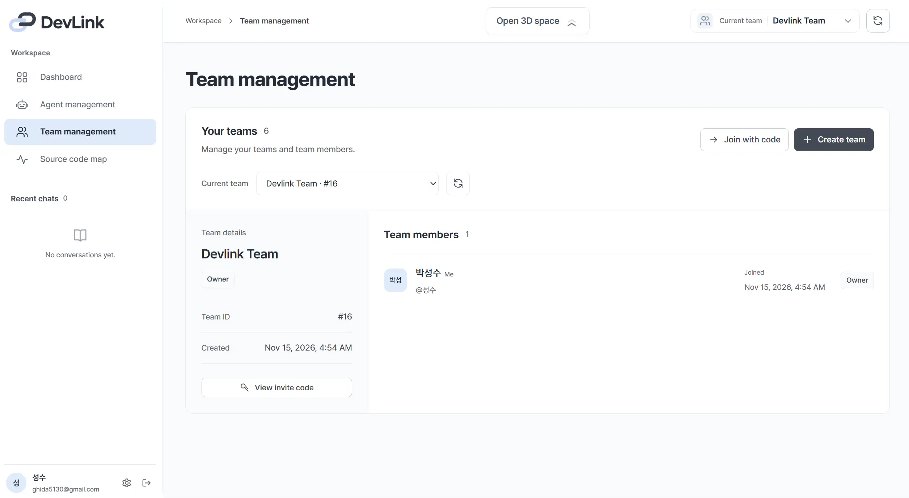
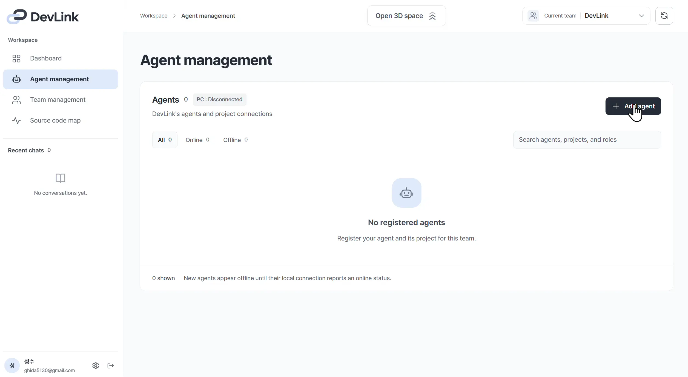
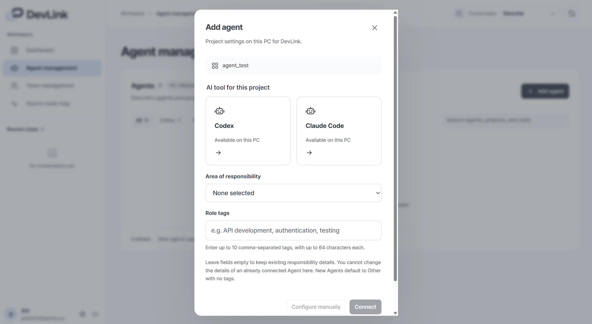
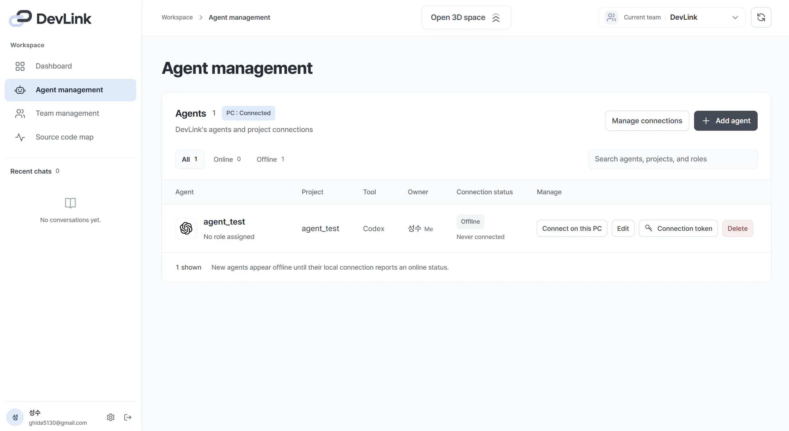

# DevLink User Guide

A first-time user's guide to signing up, connecting a project, and completing your first collaboration.

Based on the implementation reviewed on November 13, 2026. This guide focuses on the Windows desktop app.

**English** · [한국어](DevLink_User_Guide.ko.md)

## Contents

1. [What you can do with DevLink](#1-what-you-can-do-with-devlink)
2. [Choose how to get started](#2-choose-how-to-get-started)
3. [Install and sign up](#3-install-and-sign-up)
4. [Create or join a team](#4-create-or-join-a-team)
5. [Connect your project and AI tool](#5-connect-your-project-and-ai-tool)
6. [Send and complete your first task](#6-send-and-complete-your-first-task)
7. [Ask questions and request code changes](#7-ask-questions-and-request-code-changes)
8. [Use the dashboard and additional features](#8-use-the-dashboard-and-additional-features)
9. [Return to an existing connection](#9-return-to-an-existing-connection)
10. [Troubleshooting](#10-troubleshooting)
11. [Connect directly with the CLI](#11-connect-directly-with-the-cli)
12. [Run the server, frontend, and client locally](#12-run-the-server-frontend-and-client-locally)

## 1. What you can do with DevLink

DevLink connects your team's AI coding tools so you can **request work, exchange questions and answers, and follow progress and results together**.

For example, a frontend developer can use Codex to ask a backend developer's Claude Code to check the login API's response format. The backend developer reviews the request and performs the work in their own AI tool. Both people can follow the same task's conversation and results in DevLink.

Project analysis, code changes, and tests run in each user's Codex or Claude Code session. Registering a result does not automatically apply the recipient's code changes to the requester's computer.

### Terms to know

| Term | Meaning |
| --- | --- |
| Team | A shared space for users and Agents working together |
| Agent | A participant connected to a particular user, team, project, and AI tool |
| Project | A folder on your computer that the AI tool can analyze or modify |
| MCP | The connection that lets your AI tool use DevLink features |
| Broker | A local program that maintains communication between your AI tool and the central server |
| Profile | Local settings identifying the server, account, team, project, and Agent for a connection |
| Task | A record containing a request, status, questions, answers, and results |
| Connection token | A secret used to authenticate an Agent connection; prepared during setup and never shared |

### What the three repositories provide

| Component | Responsibility | What a typical user does |
| --- | --- | --- |
| frontend | Web dashboard and Windows desktop app | Sign up, prepare a team, connect projects, and review tasks |
| client | CLI, local broker, and MCP server | Follow the desktop app's instructions to connect an AI tool |
| server | Authentication, storage, and delivery of team, Agent, and task data | No separate installation when using the hosted service |

## 2. Choose how to get started

| Goal | Method | Sections |
| --- | --- | --- |
| Connect an AI tool and collaborate on Windows | Desktop installer | 3–10 |
| Sign up or explore team task records first | Web browser | 3–4 and 8 |
| Connect without the app, or use Linux or macOS | Client CLI release | 11, then 6–10 |
| Run the complete service independently of production | Local server + frontend + client | 12, then 4–10 |

**The Windows desktop app is the easiest starting point for new users.** Its installer includes the DevLink CLI, MCP server, and Node.js runtime. You do not need to clone all three repositories or install Java, Rust, or Docker for this route.

You can also sign up and view teams and tasks in a browser. Use the desktop app or CLI to connect a project on your computer.

### What you need

- A Windows x64 computer with internet access
- Codex or Claude Code, installed, signed in, and able to respond to prompts
- A local project folder you can open in your AI tool
- An email address and password for DevLink
- One teammate for the first task roundtrip, with their own account, project, and AI tool

Your DevLink account is separate from your AI tool account. Each user needs the access required by their AI tool. You can sign up, create a team, and check a connection on your own; use a teammate to verify collaboration between different users.

## 3. Install and sign up

### 3-1. Install the desktop app

1. Open [DevLink Frontend Releases](https://github.com/SSAFY-URAYAHA/DevLink_frontend/releases).
2. Download the Windows installer, `DevLink-Setup-<version>.exe`. Replace `<version>` with the version shown in the actual filename.
3. Run the installer, then launch DevLink from its shortcut.

If no installer is listed, ask the release maintainer for a build, use the CLI in section 11, or follow the local setup in section 12. The repository's source ZIP is different from the Windows installer.

The installed app connects to the production web interface and central server. Internet access is required.

### 3-2. Sign up and log in

1. On the login screen, select **Sign up (회원가입)**.
2. Enter your name, email address, and password. A nickname is optional.
3. After registration, **Log in (로그인)** with the same email and password.

Passwords must contain 8–32 characters and combine at least three of these categories: uppercase letters, lowercase letters, numbers, and special characters. Spaces and Korean characters are not allowed.

**Expected result:** A first-time account sees **Get started with DevLink (DevLink 시작하기)**, with steps for preparing a team, connecting a project, and completing setup. Accounts that already have an Agent may go directly to the dashboard.

To start in a browser, open [DevLink Web](https://devlink.ai.kr). Accounts and teams created there are also available in the desktop app when both use the same production server.

## 4. Create or join a team

### If you are creating the team

1. Open **Team management (팀 관리)** and select **Create team (팀 만들기)**.
2. Enter a team name and select **Create team**. DevLink makes you the team owner and issues the first invitation code automatically.
3. In the **Team created (팀 생성 완료)** dialog, select **Copy code (코드 복사)**. Share the invitation code so your teammates can join the team.



If you are on the onboarding screen, choose **Create a new team (새 팀 만들기)**. You can copy the first invitation code during onboarding too.

### If you have been invited

1. Log in with your own account.
2. In **Team management**, select **Join with code (코드로 참여)**. On the onboarding screen, choose **초대 코드로 참여**.
3. Enter the invitation code from your teammate and confirm to join.
4. Check the name of the team you joined.

If you belong to multiple teams, **select the team you intend to work with first**.

**Expected result:** Both users see the same team, and each person's account appears in the team member list.

If you regenerate an invitation code, review the on-screen notice and share the new code instead of the previous one.

## 5. Connect your project and AI tool

Each teammate completes this section in the DevLink desktop app on their own computer.

### 5-1. Select a project

1. In **Agent management (Agent 관리)**, select **Add agent (Agent 추가)**. If you are on the onboarding screen, continue to **Connect project (프로젝트 연결)**.
2. Click **Select folder (폴더 선택)** and choose the local project root you want to work in. For a frontend project, this might be the folder containing `package.json` and `src`.



If you chose **Set up later (나중에 설정)** during onboarding, you can return to **Add agent** when ready.

### 5-2. Select a tool and responsibilities

1. Select **Codex** or **Claude Code**. If DevLink detects only one tool, it selects it automatically.
2. Under **Area of responsibility (담당 파트)**, select **Frontend**, **Backend**, **Infrastructure**, or **Other**.
3. Enter **Role tags (역할 태그)**, such as `login, authentication, API`.
4. Click **Connect (연결하기)**. DevLink registers the Agent and automatically configures MCP for the selected project. If the app prompts for your password or asks you to review settings, follow section 5-3. Once setup is complete, use section 5-4 to bring the Agent online.



Role tags are comma-separated, with up to 10 tags and 64 characters per tag. Describe the features you actually own, since these tags help identify the right Agent later.

For a new Agent, leaving these fields empty registers it as Other with no tags. For an existing Agent, blank fields preserve existing information. Use Agent metadata editing to change existing responsibilities rather than trying to overwrite them in the project connection screen.

### 5-3. Authenticate and apply MCP settings

1. If prompted, enter your current DevLink password in the **desktop app's password field**.
2. Follow the progress for Agent preparation, broker startup, and MCP configuration.
3. Review and apply configuration changes when prompted.
4. If manual instructions appear, add the displayed DevLink configuration to the indicated file, then select **Check configuration (설정 확인)**.

| AI tool | Project-level MCP configuration |
| --- | --- |
| Codex | `<project>/.codex/config.toml` |
| Claude Code | `<project>/.mcp.json` |

Preserve other MCP servers and settings already present in these files. Add or update only the DevLink entry. The generated configuration uses paths for your computer, so do not copy someone else's configuration unchanged.

**If token issuance is requested:** This computer may not have the token for an existing Agent. Issuing another token can disconnect another computer using that Agent. Check the Agent ID and intended connection before proceeding.

### 5-4. Reopen your AI tool and verify the connection

In **Agent management**, find the offline Codex Agent you set up on this PC and select **Connect on this PC (이 PC에서 연결)**. The desktop app starts the local broker and opens the saved project in Codex. If Codex asks you to approve the DevLink connection, approve it in the terminal. Check that the Agent status changes to **Online (온라인)**.



For Claude Code or when the button is unavailable, open **the same project** in your AI tool. If Codex asks whether to trust the folder, confirm it is the intended project before granting trust. If Claude Code asks to use the DevLink MCP server, approve it.

To check the connection and bind the session if needed, enter this prompt in your AI tool.

```text
Check my DevLink connection.
Use get_connection_status to inspect the connection,
then use get_my_context to verify my account, team, Agent, and project.
If the checks pass and the session needs binding, call register_agent
with no arguments.
Then check the connection again and show the team's Agents.
```

Here, `register_agent` binds the current AI tool session to the Agent you already prepared. Agent creation happened earlier through project setup in the app or CLI.

### How to recognize a working connection

| Check | Expected result |
| --- | --- |
| MCP tools | Your AI tool can use DevLink tools |
| Local broker | `running` |
| Central server connection | `Connected` |
| Credentials and identity | `credentials=valid`, `identity=verified` |
| Your information | Matches the intended account, team, Agent, and project |
| AI tool session | `hostSession=bound` after binding |
| Team Agent list | Identifies your Agent and your teammate's Agent |

In the app, you can also use **Connection management (연결 관리) → Check configuration (설정 확인) / Check AI tool connection (AI 도구 연결 확인)**. Configuration readiness and an actual AI tool session connection are displayed separately. An Agent appearing in the list or having a token does not by itself mean it is online.

MCP diagnostics may show `mcpConfig=unknown`, `setupReady=false`, or `collaborationReady=false` together with an otherwise healthy connection. These values can reflect MCP's inability to inspect the AI tool's complete configuration. Do not judge the connection by one of these values alone; check connection, identity, session binding, and the app's configuration inspection together.

## 6. Send and complete your first task

For your first exercise, **analyze a project and return a result without modifying code**. User A is the requester; user B is the recipient. Keep B's AI tool open in the connected project.

### 6-1. A: Identify the recipient Agent

Enter this in A's AI tool:

```text
Show the Agents in my DevLink team.
Include each Agent's name, ID, tool, owner when available,
online status, and responsibilities.
Do not send a task yet.
```

Confirm B's Agent name, ID, and project with B. Replace `<recipient Agent ID>` in the next prompt with the actual ID returned by the lookup.

### 6-2. A: Send the first task

```text
Send this task through DevLink to Agent <recipient Agent ID>.

Title: First connection check — explain the project structure
Purpose: Verify that DevLink can deliver a task and return its result.
Request: Read the README and inspect the main folders in your connected
project. Briefly explain the project's purpose, the main folders,
and how to run it.
Scope: Do not modify files, install dependencies, commit, or push.
Completion criteria: Register your explanation and the files you inspected
as the task result. Mark anything not supported by the documentation
as unverified rather than guessing.

After sending, report the taskId and its storage and delivery status.
```

**Expected result:** A task ID is returned, and the task appears as **Pending acceptance (수락 대기 / PENDING)**. Delivery status and task status are separate: a delivered task can still be waiting for acceptance.

### 6-3. B: Read the received task

Enter this in B's AI tool:

```text
Check my received DevLink tasks.
Read the details of the new task titled
'First connection check — explain the project structure'.
Show its taskId, requester, request, and current status.
Do not start the work yet.
```

**Expected result:** The title, content, and task ID match A's request. Receiving a notification or reading the task does not accept it.

### 6-4. B: Accept and perform the work

Replace `<task ID>` with the actual ID and enter this in B's AI tool:

```text
Accept DevLink task <task ID> and work within its requested scope.
Read the latest details and current status first.
If it is pending, change it to in progress.
If I have already accepted it and it is in progress, continue without
repeating the state transition.
Do not modify files. Write an explanation based on the files you actually
inspect, then register the completed result in DevLink.
```

The reviewed source also includes an **Accept (수락)** button in the task detail screen. It appears for a pending task when the server indicates that the logged-in owner of the recipient Agent may accept it. If you accept in the interface, ask B's AI tool to continue the task as above. The button changes task status; analysis and code execution happen in the AI tool.

If your installed version does not have this button, accept and proceed through the AI tool prompt.

**Expected result:** The task moves through **In progress (진행 중 / IN_PROGRESS)** to **Completed (완료 / COMPLETED)**, with the explanation saved as its result.

### 6-5. A: Review the result

Enter this in A's AI tool:

```text
Check the latest status and completed result of DevLink task <task ID>.
Summarize the files inspected, the explanation, and any unverified items.
```

In the DevLink app or web interface, open **Recent tasks → the task** and confirm that the same result is visible. This roundtrip verifies sign-up, team membership, local connections, task delivery, acceptance, and result retrieval.

### Understand task statuses

| Interface label | Status code | Meaning |
| --- | --- | --- |
| Pending acceptance (수락 대기) | `PENDING` | The request is saved and awaiting acceptance |
| In progress (진행 중) | `IN_PROGRESS` | The recipient has accepted the task |
| Completed (완료) | `COMPLETED` | A result has been registered |
| Failed (실패) | `FAILED` | Accepted work could not be completed; review the reason |
| Rejected (거절) | `REJECTED` | The recipient declined before accepting |

Completed means a result was registered. Also review the checks actually performed, changed files, and remaining issues.

## 7. Ask questions and request code changes

### 7-1. Ask and answer within the same task

When B needs clarification during a task, enter:

```text
Send this question on DevLink task <task ID>:
'What message should users see when login fails?'
Leave the question on the task rather than deciding the answer yourself.
```

After reviewing the question, A enters:

```text
Check the question on DevLink task <task ID> and reply to it with:
'Please check your email address or password.'
```

Questions and answers belong to the same in-progress task and are exchanged by its requester and recipient. Check the task ID and question before replying. You do not need a new task for each question. If a notification does not appear immediately, ask the AI tool to read the task details again.

### 7-2. Template for a code change request

After verifying your first roundtrip, fill in this template:

```text
Send the following task through DevLink to <actual recipient Agent ID>.

Title: <short task title>
Purpose: <why this is needed>
Current problem: <when the problem occurs and what happens>
Requested behavior: <what should happen>
Recipient project: <repository and branch confirmed with the recipient>
Related files/API: <known project-relative paths or API endpoints>
Completion criteria: <how completion should be assessed>
Verification: <relevant existing tests or checks>
Scope: <what may change and what is excluded>
Result: Register changed files, a summary of changes, checks actually run,
and remaining issues.
```

Use paths relative to the recipient's project instead of guessing their absolute local paths. Do not include passwords, connection tokens, or secrets from environment files in requests or results.

Registering the recipient's result does not automatically update your repository. Share code through your team's Git branches, pull requests, and merge process. If commits or pushes are required, include them explicitly in the task scope.

### 7-3. Find the right Agent

```text
Find DevLink Agent candidates responsible for
'the login API and authentication error handling'.
Show each candidate's name, ID, connection status, and recommendation evidence.
Do not send a task until I choose a recipient.
```

Candidates depend on role tags and collected Git evidence. If there is no useful recommendation or evidence is insufficient, check the team's Agent list directly. Recommendation ranking and online status are separate information.

## 8. Use the dashboard and additional features

### Teams, Agents, and tasks

| Screen or feature | What to check |
| --- | --- |
| Team management | Current team, members, team creation and joining, invitation codes |
| Agent | Team Agents, responsibilities, and online status |
| Connection management (연결 관리) | This computer's connections for the current account and team, MCP settings, and AI tool session status |
| Recent tasks | Team-wide tasks and statuses, including tasks you did not participate in |
| Task details | Request, questions, answers, state changes, results, and changed files |
| Open 3D space (3D 스페이스로 가기) | Team and Agent connections and collaboration activity in a spatial view |

### Notifications

The desktop app periodically checks connected local profiles for new tasks, questions, answers, and results. When the app is in the foreground, it shows in-app notifications. When another window is active, Windows notifications may also appear. Click a notification to open the task conversation.

Exiting the app stops desktop notification checks. A profile's first check does not replay its entire notification history, so you can also query received tasks directly through your AI tool.

### Repository dependencies and change impact

Log in to the production website and open the [team code map](https://devlink.ai.kr/tree?mode=team). A team OWNER must configure the repository key, base branch, publishing Agent, and related settings, and the broker must upload analysis data before a real graph appears. It may be empty immediately after connecting.

The [sample code map](https://devlink.ai.kr/tree) displays example data without login. Distinguish it from your team's actual analysis. See the client and frontend references in section 14 for repository analysis and publishing configuration.

### Team Context

Ask your connected AI tool to retrieve the team's development context and unresolved issues. Summaries update asynchronously, so a recent question or answer may not appear yet. For important decisions, also read the relevant task's latest details.

## 9. Return to an existing connection

1. Open DevLink and check the account and team you want to use.
2. Open the previously connected project in the same AI tool.
3. Use **Connection management (연결 관리)** to inspect configuration and AI tool session status.
4. If the broker is stopped, select **Resume connection (연결 재개)** for the existing connection.
5. Run the connection check prompt from section 5-4 in your AI tool.
6. Check the latest statuses of received and sent tasks.

Do not assume the broker starts automatically after a reboot. Reuse the existing connection for the same project and tool rather than creating a new Agent each time.

| Situation | What to do |
| --- | --- |
| Return to the same project | Inspect and resume its existing connection |
| Use both Codex and Claude Code for one project | Prepare a separate connection and Agent for each tool |
| Connect two Agents to the same tool in one project | Unsupported; organize the project/tool connections first |
| Use an existing Agent on a new computer | Check existing connections and the impact of token reissuance |
| Update the AI tool or DevLink app | Reopen the AI tool and verify the connection |
| Move the project folder | Prepare the connection again, since paths and settings have changed |

Web logout and Agent disconnection are separate. To explicitly stop a broker, use the CLI's `stop` command for that profile. Always specify the same profile path, as described in section 11.

## 10. Troubleshooting

First identify the last successful stage: interface login → team → local configuration → central connection → AI tool session → task roundtrip.

| Symptom | Checks and next steps |
| --- | --- |
| No installer available | Check release assets; ask the maintainer for an installer, or use the CLI/local setup |
| Login screen cannot reach the server | Check internet access and server availability; for local setup, check health and frontend proxy settings |
| Password rejected | Check the 8–32 character limit, three character categories, and absence of spaces or Korean characters |
| Invitation code does not work | Check whitespace, whether the code was regenerated, and whether both users use the same server |
| No project folder selection | Check whether you are using a browser or the desktop app; browser users can connect with the CLI |
| AI tool not detected | Verify installation and executable access; the CLI accepts `--tool-path` |
| Setup completed but Agent is OFFLINE | Reopen the same project, approve MCP/project trust when prompted, diagnose the connection, and bind the session |
| DevLink tools are missing | Check the project's MCP settings, restart the AI tool, and review the app's manual setup instructions |
| `AuthFailed` | Verify account, server, and Agent; resolve the token issue in the app, then reconnect the broker and AI tool |
| `Reconnecting` | Check networking and central server access before creating another Agent |
| `SESSION_CONFLICT` or `Replaced` | Check whether another AI session or computer owns the same Agent; close the existing owner and reconnect |
| `SETUP_UNSAFE_FILE` | Inspect permissions on the reported project, profile, or runtime path; use a private user-owned location |
| Port in use or binding denied | Set the profile's `localPort` to an available port through the CLI, restart the broker, and reopen the AI tool |
| Missing token notice | Check the Agent ID and other computers before issuing a token; reissuance affects existing connections |
| Task saved but not received | Check taskId and delivery status, verify the recipient's broker and AI session, then query received tasks |
| Sending timed out | Check sent tasks and any known taskId before assuming failure or sending again |
| Accept button missing | Check recipient ownership, pending status, and installed app/server support; accept through the AI tool if needed |
| State transition conflict (409) | Read the latest details and check whether the task was already accepted or completed |
| Task stays pending | Verify that the recipient explicitly requested acceptance and execution after reading it |
| Task stays in progress | Check whether the recipient's AI tool is working, waiting for clarification, or awaiting a local approval |
| No question or result notification | Read task details directly; check that the app is running and Windows notifications are enabled |
| Empty code map | Check sample versus team mode, OWNER repository configuration, and broker analysis uploads |

The reviewed server can save tasks for offline recipients and leave delivery pending. It retries delivery when the recipient reports being online again. Use the actual response's taskId and delivery status to assess the outcome. **Pending delivery or a timeout does not mean the task was not saved.**

When reporting a problem, include app, AI tool, and CLI versions; operating system; last successful stage; error code; taskId; and reproduction steps. Remove passwords, tokens, and secret-bearing logs.

## 11. Connect directly with the CLI

Skip this section if you already connected successfully through the desktop installer. This route is for users connecting without the app.

### 11-1. Prepare a client release

1. Download the bundle for your OS from [DevLink Client Releases](https://github.com/SSAFY-URAYAHA/DevLink_client/releases).
2. Choose Windows x64, Linux x64, or macOS Apple Silicon. The reviewed documentation does not provide a macOS Intel bundle.
3. Extract it into a private user-owned folder. If the release includes `SHA256SUMS`, compare the downloaded file's checksum.
4. Keep the `devlink` executable together with its bundled `mcp-server` folder.
5. Add the extracted folder to your user PATH and open a new terminal.
6. Install Node.js 24 or later separately. The client release bundle does not include Node.js.

```powershell
devlink --version
node --version
```

Confirm that the CLI prints its version and Node.js is version 24 or later. Linux binaries may be incompatible with your system's glibc version; use the source build instructions if necessary.

### 11-2. Connect to the hosted service

Sign up and create or join a team on DevLink Web first. In Windows PowerShell, move to your project folder and run setup. Replace the example path with your actual project.

```powershell
Set-Location 'C:\work\my-project'
devlink setup
```

Follow login → team selection → project/tool selection → Agent creation or reuse → MCP configuration. Enter your password directly in the CLI's password prompt.

The default server is the production server. If you have used the CLI for another environment, check the current profile's server first.

If the tool or Node.js is not found automatically, specify actual executable paths:

```powershell
devlink setup --tool codex --tool-path 'C:\tools\codex.exe' --node-path 'C:\Program Files\nodejs\node.exe'
```

After setup, reopen the AI tool and follow **section 5-4** to verify the MCP connection.

### 11-3. Inspect, start, and stop

| Command | Purpose |
| --- | --- |
| `devlink status` | Inspect the default profile's broker and central connection |
| `devlink setup status` | Diagnose the default profile's setup connection state |
| `devlink start` | Start the default profile's broker |
| `devlink stop` | Stop the default profile's broker |

If you used `--config` for a separate profile, include **the same path** in every management command. Desktop-managed profiles may differ from the default CLI profile; check the connection information in the app.

```powershell
devlink --config 'C:\Users\YOUR_USER\devlink-demo\config.json' status
devlink --config 'C:\Users\YOUR_USER\devlink-demo\config.json' setup status
devlink --config 'C:\Users\YOUR_USER\devlink-demo\config.json' start
devlink --config 'C:\Users\YOUR_USER\devlink-demo\config.json' stop
```

These are separate operations, not four steps to run together. Choose only the action you need.

### 11-4. Enable AI tool update hooks — optional

For a CLI-connected profile, preview and apply the hook installation with the commands below. Include the same `--config` if you use a separate profile.

```powershell
devlink hooks install --host codex
devlink hooks install --host codex --yes
```

For Claude Code, replace `codex` with `claude-code`. Codex requires a one-time trust approval through `/hooks`. Reopen your AI tool after installation.

Hooks provide updates at session start and prompt submission. They are separate from Windows notifications and do not accept tasks on your behalf. You can query received tasks manually without hooks.

## 12. Run the server, frontend, and client locally

This section is for developers and contributors running the complete service on their own computer. **Run the central server and database once, then prepare each user's client to connect to that server.** Commands below use Windows PowerShell on a single computer.

| Component | Requirements |
| --- | --- |
| server + PostgreSQL | Git, running Docker Desktop, Docker Compose v2 |
| frontend | Git, Node.js 24, npm |
| client release | OS-specific bundle, Node.js 24 or later, installed AI tool |
| Additional client source build requirements | Rust stable; on Windows, MSVC C++ Build Tools and Windows SDK |

The Docker server route does not require a host JDK or Gradle installation. JDK 21 is needed only when running the server directly on the JVM.

### 12-1. Get the source

Clone the required repositories into a new working folder. If they already exist at the example location, use those directories instead of cloning again.

```powershell
New-Item -ItemType Directory -Force "$HOME\devlink-local" | Out-Null
Set-Location "$HOME\devlink-local"
git clone https://github.com/SSAFY-URAYAHA/DevLink_server.git
git clone https://github.com/SSAFY-URAYAHA/DevLink_frontend.git
```

Clone the client only if you intend to build it from source:

```powershell
git clone https://github.com/SSAFY-URAYAHA/DevLink_client.git
```

### 12-2. Prepare the server environment file

Prepare `.env` in the server repository. Run this **once in a fresh checkout**; it stops if `.env` already exists.

```powershell
Set-Location "$HOME\devlink-local\DevLink_server"
if (Test-Path .env) { throw 'Review the existing .env and change only the necessary values.' }
$cursorKeyBytes = New-Object byte[] 32
$cursorKeyGenerator = [System.Security.Cryptography.RandomNumberGenerator]::Create()
$cursorKeyGenerator.GetBytes($cursorKeyBytes)
$cursorSecret = [Convert]::ToBase64String($cursorKeyBytes)
$cursorKeyGenerator.Dispose()
$localEnv = (Get-Content .env.example -Raw).Replace(
  'TASK_MESSAGE_CURSOR_SECRET=',
  "TASK_MESSAGE_CURSOR_SECRET=$cursorSecret"
)
[System.IO.File]::WriteAllText(
  (Join-Path (Get-Location) '.env'),
  $localEnv,
  [System.Text.UTF8Encoding]::new($false)
)
```

`TASK_MESSAGE_CURSOR_SECRET` is a required signing key. The server will not start if it is empty. Keep the same value across restarts. Do not commit `.env`.

No external LLM API key is required for the basic request, acceptance, and result exercise. Configure one separately only if you want external LLM summaries for Team Context.

### 12-3. Start the server and database

Run these commands in the server folder:

```powershell
docker compose version
docker compose up -d --build
docker compose ps
Invoke-RestMethod 'http://localhost:8080/api/v1/health'
```

A healthy response includes `success: true` and `data: UP`. The first run may take time to download images, build the application, and migrate the database.

If startup fails, inspect the logs:

```powershell
docker compose logs -f app
```

Press `Ctrl+C` to stop following logs; the containers continue running.

If ports 5432 or 8080 are already in use, identify the existing service and resolve the conflict, or change the Compose port mappings and all affected connection addresses together.

### 12-4. Start the frontend

Open **a new PowerShell window**:

```powershell
Set-Location "$HOME\devlink-local\DevLink_frontend"
npm ci
if (!(Test-Path .env.local)) { Copy-Item .env.example .env.local }
```

Open `.env.local` and confirm these values:

```dotenv
VITE_API_BASE_URL=
DEVLINK_API_PROXY_TARGET=http://localhost:8080
```

Start the development server:

```powershell
npm run dev -- --host localhost --port 5173 --strictPort
```

Open [http://localhost:5173](http://localhost:5173). Leave the terminal running, then sign up and create or join a team in the local interface.

Local database accounts are separate from production service accounts. For test accounts A and B, use separate browsers or a private window to keep login sessions separate.

With this configuration, Vite forwards `/api` requests to the server, so the basic local exercise does not require changing server CORS settings. If you configure the browser to call the API directly, add the actual frontend origin to the server's `CORS_ALLOWED_ORIGINS`. Do not append `/api` or `/api/v1` to `VITE_API_BASE_URL`.

### 12-5. Prepare the client

Use the release bundle from section 11 to skip source compilation. To build from source:

```powershell
Set-Location "$HOME\devlink-local\DevLink_client\packages\mcp-server"
npm ci
npm run build
Set-Location "$HOME\devlink-local\DevLink_client\rust"
cargo build --release --locked -p devlink-cli
```

The outputs are `rust/target/release/devlink.exe` and `packages/mcp-server/dist/index.js`. A Windows source build requires Rust and C++ Build Tools.

### 12-6. Point the client at the local server

This example creates a **new test profile**. If you are using a release bundle, replace `$cliPath` with the absolute path to its `devlink.exe`.

```powershell
$cliPath = "$HOME\devlink-local\DevLink_client\rust\target\release\devlink.exe"
$profileDir = Join-Path $HOME 'devlink-demo-agent-a'
New-Item -ItemType Directory -Force $profileDir | Out-Null
$profilePath = Join-Path $profileDir 'config.json'
if (Test-Path $profilePath) { throw 'This profile already exists. Inspect its connection first.' }
& $cliPath --config $profilePath init
if ($LASTEXITCODE -ne 0) { throw 'Profile initialization failed.' }
& $cliPath --config $profilePath config set serverUrl 'ws://localhost:8080'
if ($LASTEXITCODE -ne 0) { throw 'Server URL configuration failed.' }
```

Run setup from the actual project you want to connect. Replace the project path below. This example explicitly selects the source-built MCP entry point:

```powershell
Set-Location 'C:\work\my-project'
& $cliPath --config $profilePath setup --tool codex --mcp-entry "$HOME\devlink-local\DevLink_client\packages\mcp-server\dist\index.js"
```

For Claude Code, use `--tool claude-code`. A release bundle discovers the MCP server beside its executable, so you can omit `--mcp-entry` when using that layout.

**Log in with the account created in your local interface, rather than a production account**, and select the same local team. Finish Agent creation or reuse and MCP configuration, reopen the AI tool, and run the connection check in section 5-4.

If your web interface is local but your client still points at production, they will display different teams and tasks. Make sure all three components use the intended server.

| Connection | Single-computer local address |
| --- | --- |
| User interface | `http://localhost:5173` |
| Server REST API | `http://localhost:8080/api/v1` |
| Client `serverUrl` | `ws://localhost:8080` |
| Broker WebSocket endpoint | `ws://localhost:8080/ws/broker` |
| Database | PostgreSQL managed by Compose |

To test multiple users or Agents, prepare separate profiles for each user, project, and tool. **Do not overwrite the same project's same-tool MCP entry with two different profiles.**

For teammates on different computers, `localhost` refers to each person's own computer. Use a shared HTTPS/WSS server and frontend address instead of copying this single-computer address table. The client does not allow unencrypted `ws://` connections except to loopback addresses.

### 12-7. Run the local desktop app — optional

The browser + CLI combination is sufficient for the exercise in section 6. Add this step only if you want to develop or inspect the desktop project connection interface itself.

1. Keep Vite running on port 5173.
2. Run `npm ci` in `DevLink_frontend/desktop`.
3. Copy its `.env.example` to `.env.local` and enter the actual CLI, MCP, and Node.js paths.
4. Set `DEVLINK_DESKTOP_CONFIG_PATH` to a **separate base profile** configured for the local server. For example, use a new `devlink-desktop-local/config.json` path and apply the initialization and `serverUrl` steps from section 12-6.
5. Run `npm run dev` in the same `desktop` folder.

```dotenv
DEVLINK_DESKTOP_CLI_PATH=../../DevLink_client/rust/target/release/devlink.exe
DEVLINK_DESKTOP_MCP_ENTRY=../../DevLink_client/packages/mcp-server/dist/index.js
DEVLINK_DESKTOP_NODE_PATH="C:/Program Files/nodejs/node.exe"
DEVLINK_DESKTOP_CONFIG_PATH=C:/Users/YOUR_USER/devlink-desktop-local/config.json
```

These values assume the repositories are sibling directories. Replace `YOUR_USER` and the Node.js path with actual values. The app may prepare separate profiles per account, team, project, and tool. Check the target connection and close any existing session before reconnecting the same project and tool through the app.

The downloaded production installer uses the production web interface and server. Starting a local server does not change the installed app's connection target.

### 12-8. Stop and restart

| Component | Stop | Restart |
| --- | --- | --- |
| Frontend development server | `Ctrl+C` in its terminal | Run the same dev command in the frontend folder |
| Client broker | `devlink stop` with the correct profile | `devlink start` with the same profile, then verify the AI tool connection |
| Server and database | `docker compose down` in the server folder | `docker compose up -d` |

Plain `docker compose down` preserves the database volume. Adding `-v` may delete local database data; do not use it for a normal shutdown.

Repositories: [Client](https://github.com/SSAFY-URAYAHA/DevLink_client) · [Server](https://github.com/SSAFY-URAYAHA/DevLink_server) · [Frontend](https://github.com/SSAFY-URAYAHA/DevLink_frontend)
