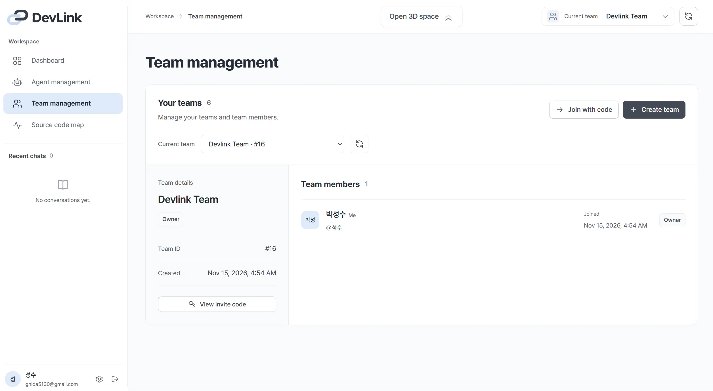
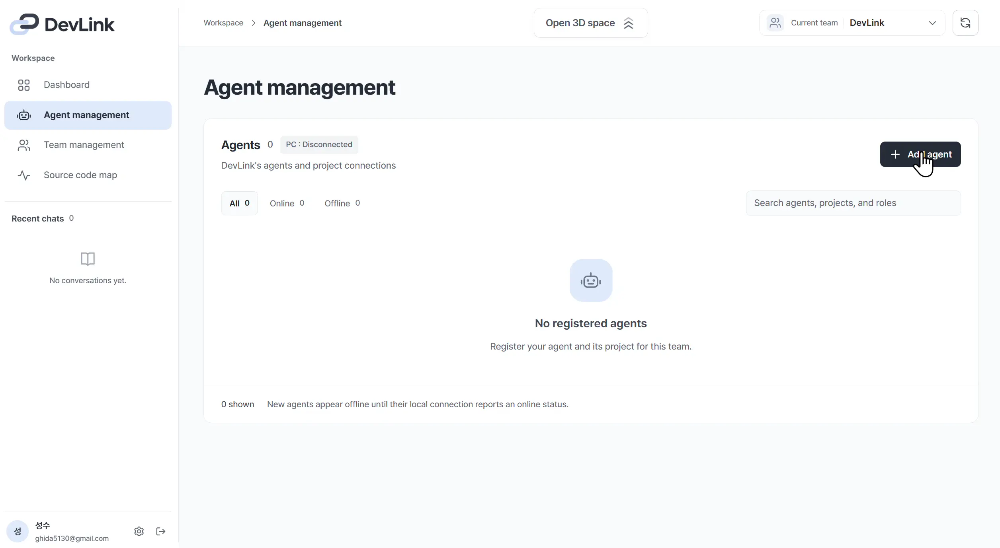
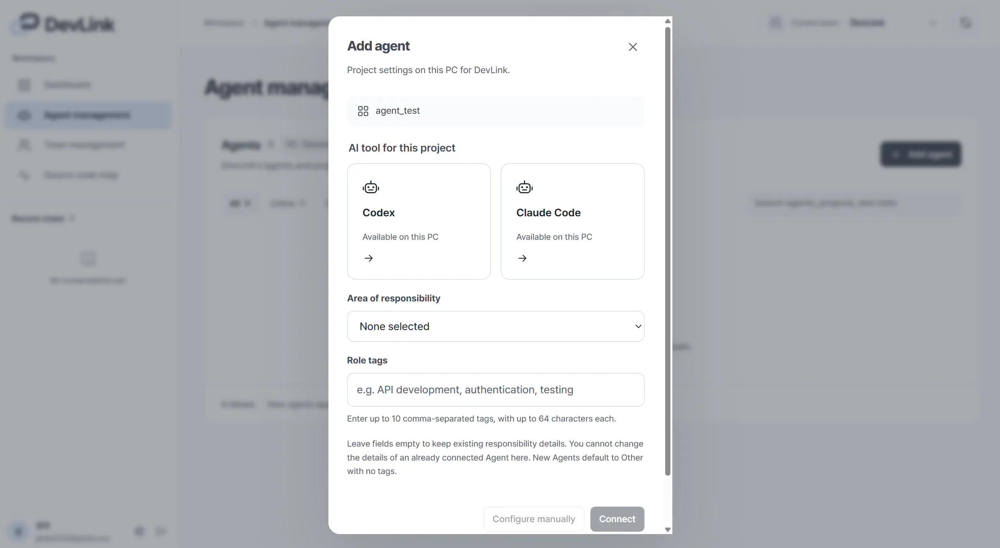
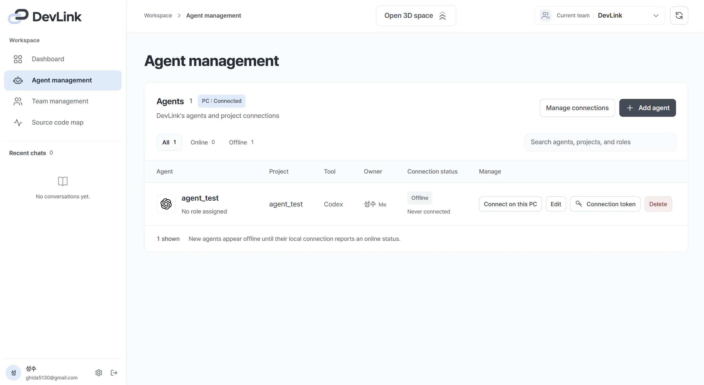

# DevLink 사용설명서

[English](DevLink_User_Guide.en.md) · **한국어** 

## 목차

1. [DevLink로 할 수 있는 일](#1-devlink로-할-수-있는-일)
2. [시작 방법 선택하기](#2-시작-방법-선택하기)
3. [설치하고 가입하기](#3-설치하고-가입하기)
4. [팀 만들기와 참여하기](#4-팀-만들기와-참여하기)
5. [내 프로젝트와 AI 도구 연결하기](#5-내-프로젝트와-ai-도구-연결하기)
6. [첫 작업 주고받기](#6-첫-작업-주고받기)
7. [질문·답변과 코드 수정 요청하기](#7-질문답변과-코드-수정-요청하기)
8. [대시보드와 추가 기능 사용하기](#8-대시보드와-추가-기능-사용하기)
9. [다음 날 다시 사용하기](#9-다음-날-다시-사용하기)
10. [막혔을 때 해결하기](#10-막혔을-때-해결하기)
11. [CLI로 직접 연결하기](#11-cli로-직접-연결하기)
12. [server·frontend·client를 모두 로컬에서 실행하기](#12-serverfrontendclient를-모두-로컬에서-실행하기)

## 1. DevLink로 할 수 있는 일

DevLink는 팀원들이 사용하는 AI 코딩 도구를 연결해 **작업을 요청하고, 질문과 답변을 주고받고, 진행 상황과 결과를 함께 확인하는 서비스**입니다.

예를 들어 프론트엔드 담당자가 자신의 Codex에서 백엔드 담당자의 Claude Code로 “로그인 API의 응답 형식을 확인해줘”라는 작업을 보낼 수 있습니다. 백엔드 담당자는 내용을 확인하고 자신의 AI 도구에서 작업을 진행합니다. 두 사람은 DevLink 화면에서 같은 작업의 대화와 결과를 확인합니다.

실제 프로젝트 분석·코드 수정·테스트는 각 사용자가 열어 둔 Codex 또는 Claude Code에서 수행합니다. 결과 등록은 상대 PC의 코드를 내 PC에 자동으로 반영하는 기능과 별개입니다.

### 처음 알아둘 용어

| 용어 | 의미 |
| --- | --- |
| 팀 | 함께 작업할 사용자와 Agent가 모인 공간 |
| Agent | 특정 사용자·팀·프로젝트·AI 도구에 연결된 작업 주체 |
| 프로젝트 | AI 도구가 분석하거나 수정할 내 PC의 폴더 |
| MCP | AI 도구에서 DevLink 기능을 사용할 수 있도록 연결하는 방식 |
| 브로커 | 내 PC에서 실행되며 AI 도구와 중앙 서버 사이의 연결을 유지하는 프로그램 |
| 프로필 | 어떤 서버·계정·팀·프로젝트·Agent를 연결했는지 보관하는 로컬 설정 |
| Task / 작업 | 요청 내용, 진행 상태, 질문·답변, 결과를 묶는 단위 |
| 연결 토큰 | Agent 연결을 인증하는 비밀값. 최초 연결 과정에서 준비되며 공유하지 않음 |

### 세 저장소가 맡는 역할

| 구성 요소 | 역할 | 일반 사용자가 하는 일 |
| --- | --- | --- |
| frontend | 웹 대시보드와 Windows 데스크톱 앱 | 가입, 팀 준비, 프로젝트 연결, 작업 확인 |
| client | CLI, 로컬 브로커, MCP 서버 | 데스크톱 앱의 안내에 따라 AI 도구 연결 |
| server | 인증, 팀·Agent·작업 저장과 전달 | 운영 서비스를 이용할 때는 별도 설치 불필요 |

## 2. 시작 방법 선택하기

| 목적 | 사용할 방법 | 읽을 부분 |
| --- | --- | --- |
| Windows에서 AI 도구를 연결하고 협업하기 | 데스크톱 설치본 | 3~10절 |
| 가입하거나 팀의 작업 기록을 먼저 둘러보기 | 웹 브라우저 | 3~4절, 8절 |
| 앱 없이 연결하거나 Linux·macOS에서 사용하기 | client CLI 릴리스 | 11절 후 6~10절 |
| 운영 서비스에 의존하지 않고 전체 기능을 직접 실행하기 | 로컬 server + frontend + client | 12절 후 4~10절 |

**처음에는 Windows 데스크톱 앱으로 시작하는 편이 쉽습니다.** 설치본에 DevLink CLI·MCP 서버·Node.js 런타임이 포함됩니다. 이 경로에서는 GitHub 저장소 세 개를 모두 내려받거나 Java·Rust·Docker를 설치할 필요가 없습니다.

브라우저에서도 가입과 팀·작업 조회를 할 수 있습니다. 내 PC의 프로젝트 연결에는 데스크톱 앱 또는 CLI를 사용합니다.

### 준비물

- Windows x64 PC와 인터넷 연결
- 설치 및 로그인이 완료되어 실제 대화가 가능한 Codex 또는 Claude Code
- AI 도구로 열 수 있는 로컬 프로젝트 폴더
- DevLink에 사용할 이메일과 비밀번호
- 첫 왕복 실습을 함께할 팀원 1명: 각자 자신의 계정과 프로젝트, AI 도구를 준비

DevLink 계정과 AI 도구 계정은 별개입니다. AI 도구에 필요한 이용 권한도 각자 준비합니다. 혼자서도 가입·팀 생성·연결 확인까지 할 수 있으며, 서로 다른 사용자 사이의 협업은 팀원과 함께 확인하세요.

## 3. 설치하고 가입하기

### 3-1. 데스크톱 앱 설치

1. [DevLink Frontend Releases](https://github.com/SSAFY-URAYAHA/DevLink_frontend/releases)를 엽니다.
2. 배포된 Windows 설치 파일 `DevLink-Setup-<버전>.exe`를 내려받습니다. `<버전>`은 실제 파일에 표시된 번호입니다.
3. 설치 파일을 실행하고 설치가 끝나면 DevLink 바로가기로 앱을 엽니다.

설치 파일이 보이지 않으면 배포 담당자에게 설치본을 받거나 11절의 CLI, 12절의 로컬 실행 경로를 이용하세요. 저장소의 소스 ZIP은 Windows 설치 파일과 다릅니다.

설치 앱은 운영 웹 화면과 중앙 서버에 접속합니다. 인터넷 연결이 필요합니다.

### 3-2. 회원가입과 로그인

1. 앱의 로그인 화면에서 **회원가입**으로 전환합니다.
2. 이름, 이메일, 비밀번호를 입력합니다. 닉네임은 선택 항목입니다.
3. 회원가입이 완료되면 같은 이메일과 비밀번호로 **로그인**합니다.

비밀번호는 8~32자로 입력하며 영문 대문자·소문자·숫자·특수문자 중 3종류 이상을 조합합니다. 공백과 한글은 사용할 수 없습니다.

**확인할 결과:** 처음 사용하는 계정은 **DevLink 시작하기** 화면에서 팀 준비 → 프로젝트 연결 → 설정 완료 순서를 안내받습니다. 기존 Agent가 있는 계정은 바로 대시보드로 들어갈 수 있습니다.

웹으로 먼저 시작하려면 [DevLink 웹](https://devlink.ai.kr)을 엽니다. 웹에서 만든 계정과 팀은 같은 운영 서버를 사용하는 데스크톱 앱에서도 사용합니다.

## 4. 팀 만들기와 참여하기

### 팀을 처음 만드는 사람

1. **팀 관리**에서 **팀 만들기(Create team)**를 누릅니다.
2. 팀 이름을 입력한 뒤 **팀 만들기**를 누릅니다. 팀을 만든 계정이 소유자(OWNER)가 되고 첫 초대 코드가 자동으로 발급됩니다.
3. **팀 생성 완료** 창에서 **코드 복사(Copy code)**를 누릅니다. 초대 코드를 팀원에게 전달하면 이 코드로 같은 팀에 참여할 수 있습니다.



시작하기 화면에서는 **새 팀 만들기**를 선택합니다. 이 과정에서도 첫 초대 코드를 복사할 수 있습니다.

### 초대받은 사람

1. 자신의 계정으로 로그인합니다.
2. **팀 관리**에서 **코드로 참여(Join with code)**를 누릅니다. 시작하기 화면에서는 **초대 코드로 참여**를 선택합니다.
3. 팀원에게 받은 초대 코드를 입력하고 참여합니다.
4. 참여한 팀 이름을 확인합니다.

여러 팀이 있을 때는 **지금 작업할 팀을 먼저 선택**하세요.

**확인할 결과:** 두 사람의 화면에 같은 팀이 표시되고, 팀원 목록에 서로의 계정이 보입니다.

초대 코드를 다시 발급하는 화면이 나오면 안내를 확인하세요. 재발급 후에는 이전 코드 대신 새 코드를 전달합니다.

## 5. 내 프로젝트와 AI 도구 연결하기

팀원은 각자의 PC에서 DevLink 데스크톱 앱을 열고 아래 절차를 진행합니다.

### 5-1. 프로젝트 선택

1. **Agent 관리**에서 **Agent 추가(Add agent)**를 누릅니다. 시작하기 화면에서는 **프로젝트 연결**로 진행합니다.
2. **폴더 선택(Select folder)**을 누르고 이 PC에서 작업할 **프로젝트의 최상위 폴더**를 고릅니다. 프론트엔드 프로젝트라면 `package.json`과 `src`가 들어 있는 폴더가 한 예입니다.



시작하기 화면에서 **나중에 설정**을 선택했다면, 준비가 됐을 때 **Agent 추가**에서 연결을 시작합니다.

### 5-2. 도구와 담당 정보 선택

1. **Codex** 또는 **Claude Code**를 선택합니다. DevLink가 도구를 하나만 감지하면 해당 도구가 자동으로 선택됩니다.
2. **담당 파트(Area of responsibility)**에서 **프론트엔드**, **백엔드**, **인프라**, **기타** 중 하나를 고릅니다.
3. **역할 태그(Role tags)**를 입력합니다. 예를 들어 `로그인, 인증, API`를 입력할 수 있습니다.
4. **연결하기(Connect)**를 누르면 DevLink가 Agent를 등록하고 선택한 프로젝트의 MCP 설정을 자동으로 적용합니다. 비밀번호 확인이나 설정 검토 화면이 나오면 5-3절을 따릅니다. 설정이 끝나면 5-4절에서 Agent를 온라인으로 연결합니다.



역할 태그는 쉼표로 구분해 최대 10개, 각 64자까지 입력할 수 있습니다. 나중에 담당 Agent를 찾을 때 근거로 사용하므로 실제 담당 기능을 적는 것이 좋습니다.

새 Agent에서 담당 정보를 생략하면 기타·태그 없음으로 등록됩니다. 기존 Agent를 다시 연결할 때 빈 항목은 기존 정보를 유지합니다. 기존 담당 정보를 바꾸려면 프로젝트 연결 화면에서 덮어쓰려 하지 말고 Agent 정보 수정 기능을 사용하세요.

### 5-3. 인증과 MCP 설정 적용

1. 비밀번호 확인 화면이 나오면 **DevLink 앱의 입력란**에 현재 계정 비밀번호를 입력합니다.
2. Agent 준비, 브로커 실행, MCP 설정 진행 상황을 확인합니다.
3. 설정 변경 안내가 표시되면 내용을 확인하고 적용합니다.
4. 직접 설정 화면이 나오면 표시된 대상 파일에 DevLink 설정을 추가한 뒤 **설정 확인**을 누릅니다.

| AI 도구 | 프로젝트별 MCP 설정 위치 |
| --- | --- |
| Codex | `<프로젝트>/.codex/config.toml` |
| Claude Code | `<프로젝트>/.mcp.json` |

기존 설정 파일에 다른 MCP 서버가 있으면 보존하고 DevLink 항목만 추가·갱신합니다. 설정 예시는 해당 PC의 경로를 사용하므로 다른 사람의 설정 내용을 그대로 복사하지 마세요.

**토큰 발급 안내가 나오는 경우:** 이미 등록한 Agent의 토큰이 이 PC에 없을 수 있습니다. 재발급하면 다른 PC에서 같은 Agent로 사용하던 연결이 끊어질 수 있으므로 Agent ID와 연결 대상을 확인하고 진행합니다.

### 5-4. AI 도구를 다시 열고 연결 확인

**Agent 관리**에서 이 PC에 설정한 오프라인 Codex Agent를 찾아 **이 PC에서 연결(Connect on this PC)**을 누릅니다. 앱이 로컬 브로커를 시작하고 저장된 프로젝트를 Codex에서 엽니다. 터미널에 DevLink 연결 승인 요청이 표시되면 승인합니다. Agent 상태가 **온라인(Online)**으로 바뀌는지 확인합니다.



Claude Code를 사용하거나 버튼이 보이지 않으면 AI 도구에서 **같은 프로젝트**를 직접 엽니다. Codex에서 폴더 신뢰 여부를 물으면 연결하려는 프로젝트가 맞는지 확인한 뒤 신뢰를 선택합니다. Claude Code에서 DevLink MCP 사용을 물으면 승인합니다.

연결 상태를 확인하고 필요한 경우 세션을 연결하려면 AI 도구의 대화창에 다음 문장을 입력합니다.

```text
DevLink 연결을 확인해줘.
get_connection_status로 연결 상태를 확인하고,
get_my_context로 내 계정·팀·Agent·프로젝트가 맞는지 확인해줘.
문제가 없고 세션 연결이 필요하면 register_agent를 빈 인자로 호출해줘.
그다음 연결 상태를 다시 확인하고 같은 팀의 Agent 목록을 보여줘.
```

여기서 `register_agent`는 앞서 만든 Agent와 현재 AI 도구 세션을 연결하는 동작입니다. 새 Agent를 만드는 단계는 앱이나 CLI의 프로젝트 연결에서 이미 진행했습니다.

### 연결 완료를 판단하는 기준

| 확인 항목 | 정상적으로 기대하는 결과 |
| --- | --- |
| MCP 기능 표시 | AI 도구가 DevLink 도구를 사용할 수 있음 |
| 로컬 브로커 | `running` |
| 중앙 서버 연결 | `Connected` |
| 자격·신원 | `credentials=valid`, `identity=verified` |
| 내 정보 | 의도한 계정·팀·Agent·프로젝트와 일치 |
| AI 도구 세션 | 연결 후 `hostSession=bound` |
| 팀 Agent 목록 | 내 Agent와 팀원의 Agent가 식별됨 |

앱의 **연결 관리 → 설정 확인 / AI 도구 연결 확인**에서도 상태를 확인할 수 있습니다. 설정 준비 완료와 실제 AI 도구 세션 연결은 별도로 표시됩니다. Agent가 목록에 있거나 토큰을 발급받았다는 사실만으로 온라인 연결이 끝난 것은 아닙니다.

MCP 진단에서 `mcpConfig=unknown`, `setupReady=false` 또는 `collaborationReady=false`가 함께 나올 수 있습니다. MCP가 AI 도구의 설정 파일 전체를 관측하지 못해 생기는 값일 수 있으므로, 이 값 하나로 실패를 판단하지 마세요. 위 표의 연결·신원·세션과 앱의 설정 확인을 함께 확인합니다.

## 6. 첫 작업 주고받기

첫 실습은 **코드 수정 없이 프로젝트를 분석하고 결과를 회신하는 작업**으로 진행합니다. A는 요청자, B는 수신자입니다. B의 AI 도구와 연결할 프로젝트를 열어 둔 상태에서 시작합니다.

### 6-1. A: 받을 Agent 확인

A의 AI 도구에 입력합니다.

```text
DevLink에서 같은 팀의 Agent 목록을 보여줘.
이름, Agent ID, 도구, 소유자 정보가 있으면 소유자,
온라인 상태와 담당 정보를 함께 정리해줘.
아직 작업은 보내지 마.
```

B와 Agent 이름·ID·프로젝트가 맞는지 확인합니다. 다음 예시의 `<수신 Agent ID>`를 실제 조회한 ID로 바꿉니다.

### 6-2. A: 첫 작업 요청

```text
DevLink의 <수신 Agent ID> Agent에게 다음 작업을 보내줘.

제목: 첫 연결 확인 — 프로젝트 구조 설명
목적: DevLink 작업 요청과 결과 회신이 되는지 확인한다.
요청: 현재 연결된 프로젝트의 README와 주요 폴더를 확인해서,
프로젝트 목적, 주요 폴더의 역할, 실행 방법을 짧게 설명해줘.
범위: 파일 수정, 의존성 설치, 커밋, 푸시는 하지 않는다.
완료 기준: 확인한 파일과 설명을 결과로 등록한다.
문서에서 확인되지 않는 내용은 추측하지 않고 미확인이라고 적는다.

전송 후 taskId와 저장·전달 상태를 알려줘.
```

**확인할 결과:** 작업 ID가 발급되고 `수락 대기(PENDING)` 상태의 작업이 보입니다. 전달 상태와 작업 상태는 다를 수 있습니다. 상대에게 전달됐어도 아직 수락하지 않았다면 수락 대기입니다.

### 6-3. B: 받은 작업 읽기

B의 AI 도구에 입력합니다.

```text
DevLink에서 내가 받은 작업 목록을 확인해줘.
방금 받은 '첫 연결 확인 — 프로젝트 구조 설명' 작업의 상세를 읽고,
taskId, 요청자, 요청 내용, 현재 상태를 보여줘.
아직 작업을 시작하지 마.
```

**확인할 결과:** A가 보낸 제목·내용·작업 ID가 일치합니다. 알림을 받거나 내용을 읽는 것만으로 수락 처리되지는 않습니다.

### 6-4. B: 수락하고 실행

다음 예시의 `<작업 ID>`를 실제 ID로 바꿔 B의 AI 도구에 입력합니다.

```text
DevLink 작업 <작업 ID>를 수락하고 요청 범위대로 진행해줘.
최신 상세와 현재 상태를 먼저 확인하고,
수락 대기 상태라면 진행 중으로 바꿔줘.
이미 내가 수락해 진행 중이라면 같은 상태 변경을 반복하지 말고 이어서 진행해줘.
파일은 수정하지 말고, 실제 확인한 파일을 근거로 설명을 작성한 뒤
DevLink에 완료 결과를 등록해줘.
```

최신 소스에는 작업 상세 화면에 **수락** 버튼도 있습니다. 수신 Agent 소유자에게 서버가 수락 가능하다고 알려준 수락 대기 작업에 표시됩니다. 화면에서 수락했다면 B의 AI 도구에 위와 같이 해당 작업을 이어서 실행하도록 요청하세요. 버튼을 누르면 작업 상태가 바뀌며 실제 분석·코드 실행은 AI 도구에서 진행합니다.

설치본에 버튼이 없다면 위의 AI 도구 명령으로 수락하고 진행하면 됩니다.

**확인할 결과:** 상태가 `진행 중(IN_PROGRESS)`을 거쳐 `완료(COMPLETED)`가 되고 결과 설명이 저장됩니다.

### 6-5. A: 결과 확인

A의 AI 도구에 입력합니다.

```text
DevLink 작업 <작업 ID>의 최신 상태와 완료 결과를 확인해줘.
상대가 확인한 파일, 설명, 미확인 항목을 요약해줘.
```

DevLink 앱이나 웹의 **최근 작업 목록 → 해당 작업**을 열어 같은 내용이 보이는지 확인합니다. 이 첫 왕복이 끝나면 가입·팀·로컬 연결·요청·수락·결과 조회까지 확인한 것입니다.

### 작업 상태 읽는 법

| 화면 표시 | 상태 코드 | 의미 |
| --- | --- | --- |
| 수락 대기 | `PENDING` | 요청이 저장됐고 수신자의 수락을 기다림 |
| 진행 중 | `IN_PROGRESS` | 수신자가 수락한 작업 |
| 완료 | `COMPLETED` | 결과가 등록됨 |
| 실패 | `FAILED` | 수락 후 완료하지 못했으며 사유를 확인해야 함 |
| 거절 | `REJECTED` | 수락 전에 수신자가 거절함 |

완료는 등록된 결과를 의미합니다. 실제 실행한 검사, 수정 파일, 남은 문제도 함께 읽어야 합니다.

## 7. 질문·답변과 코드 수정 요청하기

### 7-1. 같은 작업에서 질문하기

작업 중인 B가 확인할 내용이 생기면 다음과 같이 요청합니다.

```text
DevLink 작업 <작업 ID>에 다음 질문을 보내줘.
'로그인 실패 시 사용자에게 표시할 문구는 무엇으로 할까요?'
답변이 필요한 부분은 임의로 정하지 말고 질문을 남겨줘.
```

A는 질문을 확인한 뒤 자신의 AI 도구에 입력합니다.

```text
DevLink 작업 <작업 ID>의 질문을 확인하고,
해당 질문에 '이메일 또는 비밀번호를 확인해주세요.'라고 답변을 보내줘.
```

질문·답변은 진행 중 작업의 요청자와 수신자 사이에서 같은 작업에 남깁니다. 작업 ID와 질문을 확인한 후 답변하세요. 질문 하나마다 새 작업을 만들 필요는 없습니다. 알림이 즉시 보이지 않으면 AI 도구에 작업 상세를 다시 확인해 달라고 요청합니다.

### 7-2. 실제 수정 작업 요청서

첫 왕복을 확인한 다음 아래 항목을 채워 요청합니다.

```text
DevLink의 <실제 수신 Agent ID>에게 다음 작업을 보내줘.

제목: <짧은 작업 제목>
목적: <왜 필요한지>
현재 문제: <언제, 어떤 동작에서 문제가 생기는지>
요청 내용: <원하는 동작>
수신 프로젝트: <상대방과 확인한 저장소·브랜치>
관련 파일/API: <알고 있는 프로젝트 상대 경로 또는 API>
완료 기준: <무엇을 확인하면 끝났다고 볼지>
검증: <기존 테스트·검사 중 필요한 항목>
범위: <수정 가능한 부분과 제외할 부분>
결과: 변경 파일, 수정 내용, 실제 실행한 검사와 남은 문제를 등록해줘.
```

상대방 PC의 절대 경로는 추측하지 말고 상대 프로젝트 기준 경로를 적습니다. 비밀번호·연결 토큰·환경 파일의 비밀값은 요청이나 결과에 넣지 않습니다.

상대가 결과를 등록해도 내 저장소에 자동 적용되지는 않습니다. 코드 공유에는 팀에서 사용하는 Git 브랜치·PR·병합 절차를 따릅니다. 커밋·푸시가 필요하면 해당 작업 범위도 명확히 전달하세요.

### 7-3. 담당자를 모를 때

```text
DevLink에서 '로그인 API와 인증 오류 처리' 담당 Agent 후보를 찾아줘.
후보별 이름, ID, 접속 상태와 추천 근거를 보여줘.
내가 받을 사람을 고르기 전에는 작업을 보내지 마.
```

역할 태그와 수집된 Git 근거에 따라 후보가 달라질 수 있습니다. 추천이 없거나 근거가 부족하면 팀 Agent 목록에서 직접 확인합니다. 추천 순위와 온라인 여부는 서로 다른 정보입니다.

## 8. 대시보드와 추가 기능 사용하기

### 팀·Agent·작업 확인

| 화면/기능 | 무엇을 확인하는지 |
| --- | --- |
| 팀 관리 | 현재 팀, 팀원, 팀 생성·참여, 초대 코드 |
| Agent | 팀의 Agent, 담당 정보, 온라인 상태 |
| 연결 관리 | 현재 계정·팀의 이 PC 연결, MCP 설정, AI 도구 연결 상태 |
| 최근 작업 | 팀 전체 작업과 상태. 내가 참여하지 않은 작업도 표시될 수 있음 |
| 작업 상세 | 요청, 질문·답변, 상태 변경, 완료 결과와 변경 파일 |
| 3D 스페이스로 가기 | 팀과 Agent의 연결·협업 상황을 공간 화면으로 확인 |

### 알림

데스크톱 앱은 연결된 로컬 프로필의 새 작업·질문·답변·결과 등을 주기적으로 확인합니다. 앱을 보고 있으면 앱 안 알림이, 다른 창을 보고 있으면 Windows 알림도 표시될 수 있습니다. 알림을 누르면 해당 작업 대화로 이동합니다.

앱을 종료하면 데스크톱 알림 확인도 멈춥니다. 처음 연결한 프로필은 과거 알림을 모두 다시 띄우지 않으므로, 받은 작업이 있는지는 AI 도구에서 직접 조회할 수도 있습니다.

### 코드 의존성·변경 영향 보기

운영 웹에서 로그인한 뒤 [실제 팀 코드맵](https://devlink.ai.kr/tree?mode=team)을 엽니다. 팀 OWNER가 저장소 키, 기준 브랜치, 게시 Agent 등의 설정을 준비하고 브로커가 분석 데이터를 업로드해야 실제 그래프가 표시됩니다. 첫 연결 직후 비어 있을 수 있습니다.

[샘플 코드맵](https://devlink.ai.kr/tree)은 로그인 없이 보는 예시 데이터입니다. 샘플 그래프와 우리 팀의 실제 분석 결과를 구분하세요. 저장소 분석·게시의 상세 설정은 14절의 client·frontend 안내를 참고합니다.

### 팀 Context 확인

연결된 AI 도구에서 팀의 진행 맥락과 미해결 쟁점을 조회해 달라고 요청할 수 있습니다. 요약은 비동기로 갱신되므로 방금 생긴 질문·답변은 아직 반영되지 않았을 수 있습니다. 중요한 판단은 해당 작업의 최신 상세도 함께 확인하세요.

## 9. 다음 날 다시 사용하기

1. DevLink 앱을 열고 사용할 계정·팀을 확인합니다.
2. 기존에 연결한 프로젝트를 같은 AI 도구로 엽니다.
3. 앱의 **연결 관리**에서 설정과 AI 도구 연결 상태를 확인합니다.
4. 브로커가 중지되어 있으면 기존 연결의 **연결 재개**를 사용합니다.
5. AI 도구에서 5-4절의 연결 확인 문장을 실행합니다.
6. 받은 작업과 보낸 작업의 최신 상태를 확인합니다.

재부팅 후 브로커가 자동 실행된다고 가정하지 마세요. 매번 새 Agent를 만들 필요는 없습니다. 동일한 프로젝트·도구의 기존 연결을 이어서 사용합니다.

| 상황 | 사용할 방법 |
| --- | --- |
| 같은 프로젝트를 다시 사용 | 기존 연결 확인·재개 |
| 같은 프로젝트에서 Codex와 Claude Code를 각각 사용 | 도구별로 별도 연결·Agent 준비 |
| 같은 프로젝트·같은 도구에 Agent 두 개 연결 | 지원하지 않으므로 프로젝트·도구 구성을 먼저 정리 |
| 새 PC에서 기존 Agent 사용 | 기존 연결과 토큰 재발급 영향을 확인하고 연결 |
| AI 도구나 DevLink 설치본 업데이트 | AI 도구를 다시 열고 연결 재확인 |
| 프로젝트 폴더 이동 | 기존 경로와 설정이 달라지므로 연결 관리에서 다시 준비 |

웹 로그아웃과 Agent 연결 종료는 별개입니다. 브로커를 확실히 중지하려면 해당 프로필의 CLI `stop`을 사용합니다. CLI 사용 시 11절처럼 반드시 같은 프로필 경로를 지정하세요.

## 10. 막혔을 때 해결하기

먼저 **어느 단계까지 성공했는지** 구분합니다: 화면 로그인 → 팀 → 로컬 설정 → 중앙 연결 → AI 도구 세션 → 작업 왕복.

| 증상 | 확인 및 해결 순서 |
| --- | --- |
| 설치 파일이 없음 | Releases의 Assets 확인 → 배포 담당자에게 설치본 요청 → CLI 또는 로컬 실행 이용 |
| 로그인 화면에서 서버 연결 실패 | 인터넷과 서버 상태 확인. 로컬 실행은 health 응답과 frontend 프록시 설정 확인 |
| 비밀번호가 거절됨 | 8~32자, 문자 3종류 이상, 공백·한글 여부 확인 |
| 초대 코드로 참여할 수 없음 | 코드 앞뒤 공백, 재발급 여부, 현재 서버가 같은지 확인 |
| 프로젝트 선택 기능이 안 보임 | 브라우저인지 데스크톱 앱인지 확인. 브라우저에서는 CLI로 연결 가능 |
| AI 도구를 감지하지 못함 | 해당 도구가 설치·실행 가능한지 확인. CLI는 `--tool-path`로 실행 경로 지정 가능 |
| 설정 완료인데 Agent가 OFFLINE | 같은 프로젝트로 AI 도구 다시 열기 → MCP 사용/프로젝트 신뢰 확인 → 연결 진단 후 세션 연결 |
| DevLink 도구 자체가 안 보임 | 해당 프로젝트의 MCP 설정 위치 확인 → AI 도구 재시작 → 앱의 직접 설정 안내 확인 |
| `AuthFailed` | 의도한 계정·서버·Agent인지 확인. 토큰 문제를 앱에서 복구한 뒤 브로커와 AI 도구 다시 연결 |
| `Reconnecting` | 네트워크·중앙 서버 접근 확인. 새 Agent를 만들기 전에 기존 연결 복구 여부 확인 |
| `SESSION_CONFLICT` / `Replaced` | 같은 Agent를 다른 AI 세션이나 PC가 사용 중인지 확인. 기존 소유 세션을 정리하고 재연결 |
| `SETUP_UNSAFE_FILE` | 오류에 나온 프로젝트·프로필·런타임 경로의 권한 확인. 사용자 전용 경로에서 다시 준비 |
| 포트 점유·바인딩 거부 | CLI에서 해당 프로필의 `localPort`를 사용 가능한 포트로 지정 → 브로커 재시작 → AI 도구 다시 열기 |
| 토큰이 없다는 안내 | Agent ID·다른 PC 연결 여부 확인 후 토큰 발급 진행. 재발급은 기존 연결에 영향 |
| 요청은 저장됐는데 상대가 못 받음 | taskId로 저장 여부와 전달 상태 조회 → 상대 브로커·AI 세션 확인 → 받은 목록 재조회 |
| 전송 중 시간 초과 | 실패로 단정하거나 새로 전송하지 말고 보낸 목록·taskId로 저장 여부부터 확인 |
| 수락 버튼이 안 보임 | 수신 Agent의 소유자 계정인지, 수락 대기인지, 설치본·서버가 해당 기능을 지원하는지 확인. AI 도구로도 수락 가능 |
| 상태 변경 충돌(409) | 작업 상세를 새로 읽고 현재 상태 확인. 이미 수락·완료됐는지 확인 후 진행 |
| 작업이 계속 수락 대기 | 수신자가 작업 상세를 읽고 명시적으로 수락·실행하도록 요청했는지 확인 |
| 작업이 진행 중에서 멈춤 | 수신자의 AI 도구가 실제 작업 중인지, 추가 질문이나 로컬 승인 대기가 있는지 확인 |
| 새 질문·결과 알림이 없음 | 작업 상세 직접 조회. 앱 실행 여부와 Windows 알림 설정 확인 |
| 코드맵이 비어 있음 | 샘플/팀 모드 구분 → OWNER 저장소 설정과 브로커 분석 데이터 업로드 여부 확인 |

현재 서버 소스는 오프라인 수신자에 대한 작업을 저장하고 전달 대기로 둘 수 있습니다. 이후 수신자가 다시 온라인이 되면 전달을 재시도합니다. 실제 응답의 taskId와 전달 상태를 기준으로 판단하세요. **전달 대기나 시간 초과는 작업이 저장되지 않았다는 뜻이 아닙니다.**

문의할 때는 앱·AI 도구·CLI 버전, 운영체제, 마지막으로 성공한 단계, 오류 코드, taskId, 재현 순서를 함께 적습니다. 비밀번호·토큰과 비밀값이 포함된 로그는 제거합니다.

## 11. CLI로 직접 연결하기

데스크톱 설치본으로 정상 연결했다면 이 절을 다시 진행할 필요가 없습니다. 다음은 앱 없이 연결하는 사용자를 위한 방법입니다.

### 11-1. client 릴리스 준비

1. [DevLink Client Releases](https://github.com/SSAFY-URAYAHA/DevLink_client/releases)에서 OS에 맞는 번들을 내려받습니다.
2. Windows x64 / Linux x64 / macOS Apple Silicon 중 자신의 환경을 선택합니다. macOS Intel 번들은 문서 기준 제공되지 않습니다.
3. 압축을 사용자 전용 폴더에 풉니다. 릴리스에 `SHA256SUMS`가 있다면 다운로드 파일의 해시를 비교합니다.
4. `devlink` 실행 파일과 함께 들어 있는 `mcp-server` 폴더를 같은 위치에 유지합니다.
5. 압축을 푼 폴더를 사용자 PATH에 추가하고 새 터미널을 엽니다.
6. Node.js 24 이상을 별도로 준비합니다. client 릴리스 번들은 Node.js를 포함하지 않습니다.

```powershell
devlink --version
node --version
```

CLI 버전이 출력되고 Node.js가 24 이상인지 확인합니다. Linux 바이너리는 시스템 glibc 버전 차이로 실행되지 않을 수 있으며, 이 경우 소스 빌드 안내를 사용합니다.

### 11-2. 운영 서비스에 연결

DevLink 웹에서 회원가입과 팀 생성·참여를 먼저 완료합니다. Windows PowerShell에서는 프로젝트 폴더로 이동한 뒤 실행합니다. 아래 경로는 자신의 실제 프로젝트로 바꿉니다.

```powershell
Set-Location 'C:\work\my-project'
devlink setup
```

안내에 따라 로그인 → 팀 선택 → 프로젝트·도구 선택 → Agent 생성 또는 기존 Agent 선택 → MCP 설정 적용을 진행합니다. 비밀번호는 CLI의 비밀번호 입력란에 직접 입력합니다.

기본 서버 주소는 운영 서버입니다. 이미 다른 용도로 CLI를 사용했다면 현재 프로필의 서버가 운영 서버인지 먼저 확인합니다.

도구나 Node.js 경로를 자동으로 찾지 못할 때의 예시입니다. 모든 경로는 실제 설치 경로로 바꿉니다.

```powershell
devlink setup --tool codex --tool-path 'C:\tools\codex.exe' --node-path 'C:\Program Files\nodejs\node.exe'
```

연결 후에는 AI 도구를 다시 열고 **5-4절의 MCP 연결 확인**을 진행합니다.

### 11-3. 상태·시작·중지

| 명령 | 역할 |
| --- | --- |
| `devlink status` | 기본 프로필의 브로커·중앙 연결 확인 |
| `devlink setup status` | 기본 프로필의 setup 연결 상태 진단 |
| `devlink start` | 기본 프로필의 브로커 시작 |
| `devlink stop` | 기본 프로필의 브로커 중지 |

`--config`로 별도 프로필을 사용했다면 모든 관리 명령에도 **같은 경로**를 붙입니다. 데스크톱 앱이 만든 프로필은 기본 CLI 프로필과 다를 수 있으므로 앱의 연결 관리에서 경로를 확인합니다.

```powershell
devlink --config 'C:\Users\YOUR_USER\devlink-demo\config.json' status
devlink --config 'C:\Users\YOUR_USER\devlink-demo\config.json' setup status
devlink --config 'C:\Users\YOUR_USER\devlink-demo\config.json' start
devlink --config 'C:\Users\YOUR_USER\devlink-demo\config.json' stop
```

네 줄을 한 번에 실행하는 절차가 아닙니다. 필요한 동작 하나를 선택하세요.

### 11-4. AI 도구의 새 작업 알림 설정 — 선택

CLI로 연결한 프로필에서 다음 명령으로 훅 설치 계획을 확인하고 적용할 수 있습니다. 별도 프로필이면 같은 `--config`를 붙입니다.

```powershell
devlink hooks install --host codex
devlink hooks install --host codex --yes
```

Claude Code는 `codex` 대신 `claude-code`를 사용합니다. Codex는 처음 한 번 `/hooks`에서 신뢰 승인이 필요합니다. 설치 후 AI 도구를 다시 엽니다.

이 기능은 AI 도구의 세션 시작·프롬프트 시점에 새 소식을 알려줍니다. 앱의 Windows 알림과 별개이며, 사용자를 대신해 작업을 수락하지 않습니다. 훅이 없어도 받은 작업을 직접 조회해 진행할 수 있습니다.

## 12. server·frontend·client를 모두 로컬에서 실행하기

이 절은 전체 서비스를 자신의 PC에서 실행하려는 개발자·기여자를 위한 순서입니다. **중앙 서버와 DB는 한 번 실행하고, 각 사용자는 그 서버를 가리키는 client를 준비**합니다. 아래 명령은 한 PC의 Windows PowerShell 기준입니다.

| 구성 요소 | 준비물 |
| --- | --- |
| server + PostgreSQL | Git, 실행 중인 Docker Desktop, Docker Compose v2 |
| frontend | Git, Node.js 24, npm |
| client 릴리스 | 자신의 OS 번들, Node.js 24 이상, 설치된 AI 도구 |
| client 소스 빌드 시 추가 | Rust stable, Windows는 MSVC C++ Build Tools와 Windows SDK |

서버를 Docker로 실행할 때 호스트에 JDK·Gradle은 필요하지 않습니다. JVM에서 서버를 직접 실행할 때만 JDK 21을 준비합니다.

### 12-1. 소스 받기

새 작업 폴더에서 필요한 저장소를 받습니다. 예시 폴더에 이미 저장소가 있다면 새로 clone하지 말고 해당 폴더를 사용합니다.

```powershell
New-Item -ItemType Directory -Force "$HOME\devlink-local" | Out-Null
Set-Location "$HOME\devlink-local"
git clone https://github.com/SSAFY-URAYAHA/DevLink_server.git
git clone https://github.com/SSAFY-URAYAHA/DevLink_frontend.git
```

client를 소스 빌드하는 경우에만 추가로 받습니다.

```powershell
git clone https://github.com/SSAFY-URAYAHA/DevLink_client.git
```

### 12-2. server 환경 파일 준비

server 저장소에서 `.env`를 준비합니다. 아래 코드는 **새로 받은 저장소에서 한 번만** 실행하며, 기존 `.env`가 있으면 중단합니다.

```powershell
Set-Location "$HOME\devlink-local\DevLink_server"
if (Test-Path .env) { throw '기존 .env를 확인하고 필요한 값만 수정하세요.' }
$cursorKeyBytes = New-Object byte[] 32
$cursorKeyGenerator = [System.Security.Cryptography.RandomNumberGenerator]::Create()
$cursorKeyGenerator.GetBytes($cursorKeyBytes)
$cursorSecret = [Convert]::ToBase64String($cursorKeyBytes)
$cursorKeyGenerator.Dispose()
$localEnv = (Get-Content .env.example -Raw).Replace(
  'TASK_MESSAGE_CURSOR_SECRET=',
  "TASK_MESSAGE_CURSOR_SECRET=$cursorSecret"
)
[System.IO.File]::WriteAllText(
  (Join-Path (Get-Location) '.env'),
  $localEnv,
  [System.Text.UTF8Encoding]::new($false)
)
```

`TASK_MESSAGE_CURSOR_SECRET`는 필수 서명키입니다. 비워 두면 서버가 시작되지 않습니다. 한 번 만든 값은 재시작할 때도 유지합니다. `.env`는 Git에 올리지 않습니다.

기본 작업 요청·수락·결과 실습에는 외부 LLM API 키가 필요하지 않습니다. 팀 Context의 외부 LLM 요약을 사용할 때만 별도 설정을 진행합니다.

### 12-3. server와 DB 시작

같은 server 폴더에서 실행합니다.

```powershell
docker compose version
docker compose up -d --build
docker compose ps
Invoke-RestMethod 'http://localhost:8080/api/v1/health'
```

정상 응답에는 `success: true`, `data: UP`이 포함됩니다. 첫 실행은 이미지 다운로드와 빌드, DB 마이그레이션 때문에 시간이 걸릴 수 있습니다.

실패하면 다음 명령으로 확인합니다. 로그를 계속 보는 명령은 `Ctrl+C`로 빠져나올 수 있으며 컨테이너는 계속 실행됩니다.

```powershell
docker compose logs -f app
```

5432 또는 8080 포트가 이미 사용 중이면 기존 서비스를 확인하고 충돌을 해소하거나 Compose 포트와 이후 접속 주소를 함께 변경합니다.

### 12-4. frontend 시작

**새 PowerShell**에서 실행합니다.

```powershell
Set-Location "$HOME\devlink-local\DevLink_frontend"
npm ci
if (!(Test-Path .env.local)) { Copy-Item .env.example .env.local }
```

`.env.local`을 열고 아래 값인지 확인합니다.

```dotenv
VITE_API_BASE_URL=
DEVLINK_API_PROXY_TARGET=http://localhost:8080
```

실행합니다.

```powershell
npm run dev -- --host localhost --port 5173 --strictPort
```

브라우저에서 [http://localhost:5173](http://localhost:5173)을 엽니다. 터미널을 열어 둔 채 로컬 화면에서 회원가입과 팀 생성·참여를 진행합니다.

로컬 DB의 계정은 운영 서비스 계정과 별개입니다. 테스트용 A·B 계정을 만든다면 서로 다른 브라우저나 시크릿 창을 사용해 로그인 세션을 나눕니다.

이 설정에서는 Vite가 `/api` 요청을 서버에 전달하므로 기본 로컬 실습을 위해 서버 CORS를 바꿀 필요는 없습니다. 브라우저가 API를 직접 호출하도록 설정한다면 서버의 `CORS_ALLOWED_ORIGINS`에 실제 화면 주소를 추가해야 합니다. `VITE_API_BASE_URL`에는 `/api`나 `/api/v1`을 붙이지 않습니다.

### 12-5. client 준비

11절의 릴리스 번들을 사용하면 소스 빌드를 건너뛸 수 있습니다. 소스에서 빌드하려면 다음 순서로 진행합니다.

```powershell
Set-Location "$HOME\devlink-local\DevLink_client\packages\mcp-server"
npm ci
npm run build
Set-Location "$HOME\devlink-local\DevLink_client\rust"
cargo build --release --locked -p devlink-cli
```

산출물은 `rust/target/release/devlink.exe`와 `packages/mcp-server/dist/index.js`입니다. Windows 소스 빌드는 Rust와 C++ Build Tools 설치가 필요합니다.

### 12-6. client가 로컬 server를 보도록 설정

다음은 **새 테스트 프로필**을 만드는 예시입니다. 릴리스 번들을 쓴다면 `$cliPath`를 실제 `devlink.exe` 절대 경로로 바꿉니다.

```powershell
$cliPath = "$HOME\devlink-local\DevLink_client\rust\target\release\devlink.exe"
$profileDir = Join-Path $HOME 'devlink-demo-agent-a'
New-Item -ItemType Directory -Force $profileDir | Out-Null
$profilePath = Join-Path $profileDir 'config.json'
if (Test-Path $profilePath) { throw '이미 있는 프로필입니다. 기존 연결을 먼저 확인하세요.' }
& $cliPath --config $profilePath init
if ($LASTEXITCODE -ne 0) { throw '프로필 초기화 실패' }
& $cliPath --config $profilePath config set serverUrl 'ws://localhost:8080'
if ($LASTEXITCODE -ne 0) { throw '서버 주소 설정 실패' }
```

실제로 연결할 프로젝트에서 setup을 진행합니다. 프로젝트 경로는 자신의 경로로 바꿉니다. 아래는 소스 빌드한 MCP 경로를 지정하는 예시입니다.

```powershell
Set-Location 'C:\work\my-project'
& $cliPath --config $profilePath setup --tool codex --mcp-entry "$HOME\devlink-local\DevLink_client\packages\mcp-server\dist\index.js"
```

Claude Code는 `--tool claude-code`를 사용합니다. 릴리스 번들은 실행 파일 옆 MCP를 자동으로 찾으므로 별도 `--mcp-entry` 없이 진행할 수 있습니다.

**운영 계정 대신 로컬 화면에서 만든 계정으로 로그인**하고 같은 로컬 팀을 선택합니다. Agent 생성·재사용과 MCP 설정 적용을 마친 뒤 AI 도구를 다시 열고 5-4절의 연결 진단을 실행합니다.

웹은 로컬인데 client가 기본 운영 서버를 가리키면 서로 다른 팀·작업을 보게 됩니다. 세 구성 요소의 서버가 일치하는지 확인하세요.

| 연결 대상 | 로컬 실습 주소 |
| --- | --- |
| 사용자 화면 | `http://localhost:5173` |
| server REST API | `http://localhost:8080/api/v1` |
| client의 `serverUrl` | `ws://localhost:8080` |
| 실제 브로커 WebSocket 경로 | `ws://localhost:8080/ws/broker` |
| DB | Compose의 PostgreSQL |

여러 사용자·Agent를 시험하려면 사용자·프로젝트·도구별로 별도 프로필을 준비합니다. **같은 프로젝트·같은 도구의 MCP 항목을 두 프로필로 덮어쓰지 마세요.**

다른 PC에서 공동 서버에 접속할 경우 `localhost`는 각자의 PC를 뜻합니다. 이 표의 한 PC 실습 주소를 그대로 쓰지 말고, 팀에서 공유하는 HTTPS/WSS 서버와 화면 주소를 사용하세요. client는 루프백 주소를 제외한 평문 `ws://` 연결을 허용하지 않습니다.

### 12-7. 로컬 데스크톱 앱도 띄우고 싶을 때 — 선택

브라우저 + CLI 조합만으로 6절의 작업 실습을 진행할 수 있습니다. 데스크톱 프로젝트 연결 화면 자체를 개발·확인하려는 경우에만 이 단계를 추가합니다.

1. Vite 개발 서버를 5173 포트에서 계속 실행합니다.
2. `DevLink_frontend/desktop`에서 `npm ci`를 실행합니다.
3. `.env.example`을 `.env.local`로 복사하고 실제 CLI·MCP·Node 경로를 입력합니다.
4. `DEVLINK_DESKTOP_CONFIG_PATH`에는 로컬 서버 주소를 지정한 **별도의 기준 프로필**을 넣습니다. 이 예시에서는 `devlink-desktop-local/config.json` 같은 새 경로를 만들고 12-6절의 init·serverUrl 설정 과정을 적용합니다.
5. 같은 `desktop` 폴더에서 `npm run dev`를 실행합니다.

```dotenv
DEVLINK_DESKTOP_CLI_PATH=../../DevLink_client/rust/target/release/devlink.exe
DEVLINK_DESKTOP_MCP_ENTRY=../../DevLink_client/packages/mcp-server/dist/index.js
DEVLINK_DESKTOP_NODE_PATH="C:/Program Files/nodejs/node.exe"
DEVLINK_DESKTOP_CONFIG_PATH=C:/Users/YOUR_USER/devlink-desktop-local/config.json
```

위 값은 두 저장소가 나란히 있는 폴더 구성을 기준으로 하며 `YOUR_USER`와 Node 경로를 실제 값으로 바꿉니다. 앱은 계정·팀·프로젝트·도구별 프로필을 별도로 준비할 수 있습니다. 앞서 CLI로 연결한 같은 프로젝트·도구와 중복 실행하지 않도록 기존 세션을 정리하고 연결 대상을 확인하세요.

다운로드한 운영 설치본은 운영 웹·서버를 사용합니다. 로컬 서버를 켜는 것만으로 운영 설치본의 접속 대상이 바뀌지는 않습니다.

### 12-8. 중지와 재시작

| 대상 | 중지 | 재시작 |
| --- | --- | --- |
| frontend 개발 서버 | 실행한 터미널에서 `Ctrl+C` | frontend 폴더에서 같은 dev 명령 실행 |
| client 브로커 | 해당 프로필로 `devlink stop` | 같은 프로필로 `devlink start`, 이후 AI 도구 연결 확인 |
| server·DB | server 폴더에서 `docker compose down` | `docker compose up -d` |

기본 `docker compose down`은 DB 볼륨을 유지합니다. `-v`를 붙이면 로컬 DB 데이터가 삭제될 수 있으므로 일반 종료에는 사용하지 않습니다.

관련 저장소: [Client](https://github.com/SSAFY-URAYAHA/DevLink_client) · [Server](https://github.com/SSAFY-URAYAHA/DevLink_server) · [Frontend](https://github.com/SSAFY-URAYAHA/DevLink_frontend)
